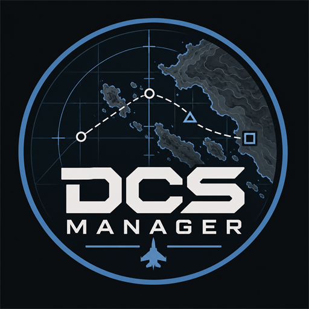

<div align="center">
  
</div>

# DCS Manager

[🇬🇧 English](README.md) | 🇫🇷 Français

Un compagnon tout-en-un pour **DCS World** — collecte des débriefings,
statistiques avancées, référence des aérodromes et cartes aéronautiques.
Il tourne
**en local, sur la même machine Windows que DCS** : un seul `dcsmanager.exe`, ni serveur,
ni conteneur, rien à configurer. Il s'ouvre dans **sa propre fenêtre**, comme un
logiciel classique : pas de navigateur à lancer, aucune adresse à retenir.

Parce qu'il est local, il peut lire les **fichiers de DCS lui-même** — les
aérodromes, fréquences et balises de chaque carte installée, ainsi que le dossier
Saved Games — au lieu de dépendre d'un jeu de données maintenu à la main.

---

## Sommaire

- [Fonctionnalités](#fonctionnalités)
- [Architecture](#architecture)
- [Prérequis](#prérequis)
- [Manuel d'installation](#manuel-dinstallation)
- [Démarrage rapide (PoC Phase 0)](#démarrage-rapide-poc-phase-0)
- [Configuration](#configuration)
- [Installation des scripts Lua dans DCS](#installation-des-scripts-lua-dans-dcs)
- [Déploiement](#déploiement)
- [Structure du projet](#structure-du-projet)
- [Roadmap](#roadmap)
- [Licence](#licence)

---

## Fonctionnalités

| Fonction | État | Détail |
|---|---|---|
| Débriefings | ✅ Phase 3 | Envoi réseau de `debrief.log`, parseur Lua, historique conservé, fusionné avec les missions dans la page **Vols** avec la chronologie complète |
| Vue d'ensemble | ✅ Nouveau | Heures de vol, missions, victoires, ratio victoires/morts, dernier vol, état DCS, plans enregistrés et check-lists récentes |
| Check-lists | ✅ Nouveau | 13 modèles génériques, création/modification/duplication/suppression, import/export JSON/CSV et exécution avec progression par appareil |
| Stats avancées | ✅ Phase 4 | Pilotes, armes, engins, balance, réseau, choix d'une mission enregistrée et évolution par mission (score, kills, atterrissages), dans la page **Statistiques** |
| Aérodromes | ✅ Phase 6 | Lus depuis les fichiers de terrain de DCS : **220 aérodromes listés, 146 plaçables** sur 6 cartes installées, avec Tower/TACAN/ILS/VOR/RSBN/NDB, et leurs cartes. Un jeu embarqué couvre le Caucase et l'Allemagne Guerre froide si DCS est introuvable |
| Cartes aéronautiques | ✅ Phase 6 | Approches et plans de mouvement indexés depuis `maps_dcs/` et affichés comme documents |
| Modules installés | ✅ Nouveau | Terrains, appareils, campagnes et packs techniques, lus depuis l'inventaire de DCS ; **possédé** (acheté) et **installé** (sur le disque) affichés séparément |
| Carrière | ✅ Nouveau | Une page **Carrière** distincte avec le carnet du joueur, les cartes et pays favoris et une heatmap quotidienne sur 30 jours |
| Paramètres | ✅ Nouveau | Un onglet regroupant les modules installés, l'installation DCS (mods, état des scripts, `Export.lua` partagé), la **sauvegarde du profil joueur** et le journal de debug en sous-onglets |
| Sauvegarde du profil | ✅ Nouveau | Sauvegarder/restaurer le logbook, les commandes (bindings), les options et les scripts (et en option kneeboard, missions, mods) dans un zip portable, depuis la CLI, l'API ou les Paramètres |
| Mods & skins | ✅ Nouveau | Une page **Bibliothèque** dédiée : activer/désactiver les mods, mettre en quarantaine et restaurer, importer des archives ZIP/7z/RAR, parcourir les livrées, détecter les structures à plat ou les packs mal placés et les classer. Voir [docs/mods-skins.fr.md](docs/mods-skins.fr.md) |
| Local par conception | ✅ Nouveau | Le desktop est un `.exe` Windows autonome : persistance SQLite dans `data/`, et toutes les lectures (terrains, Saved Games) se font sur la même machine que DCS |
| Serveur web (Docker) | ✅ Nouveau | Application web multi-utilisateurs optionnelle : comptes, rôles, journal d’audit, jetons desktop personnels et envoi des missions terminées. Le desktop fonctionne sans ; voir [docs/docker.fr.md](docs/docker.fr.md) |
| Documents partagés | ✅ Nouveau | Les check-lists ont un propriétaire et une visibilité `privée`/`escadrille` ; la synchro desktop ↔ serveur est en dernière écriture gagnante, avec tombstones et copies de conflit |
| Outils d’escadrille | ✅ Nouveau | Tableau de bord agrégé, filtres par envoyeur et par pilote, « mes vols », mise en évidence des noms DCS, association compte ↔ pilote, sauvegarde serveur et restauration des conflits |
| Récupération du mot de passe | ✅ Nouveau | Liens de réinitialisation SMTP optionnels, à usage unique et avec expiration ; un administrateur peut toujours réinitialiser un mot de passe |

> La carte temps réel (et son imagerie) a été **retirée**. La télémétrie des unités
> est toujours reçue et échantillonnée : la position actuelle sert à l'onglet
> Aérodromes (aérodrome le plus proche), et les échantillons restent stockés en
> base pour une éventuelle analyse future. L'interface affiche la vue d'ensemble,
> les vols et débriefs, la carrière, les statistiques, les check-lists, les
> aérodromes, les mods & skins et les paramètres.
### Installation Lua

Le gestionnaire lit les sessions DCS via un petit export Lua installé dans le
dossier *Saved Games* de DCS. Il transporte la télémétrie des unités, les
événements, les joueurs et le chat ; les mêmes scripts alimentent la collecte des
débriefs et les statistiques.

Fermer DCS, puis ouvrir **Paramètres → Installation DCS → Installer / mettre à jour
les scripts**. L’installateur détecte Saved Games, installe les trois fichiers
embarqués, conserve les autres exports et les réglages existants, et affiche les
sauvegardes. Il refuse l’installation si DCS.exe tourne. Relancer DCS après
l’installation.

### Statistiques avancées (prévues)

- **Fiche pilote & carrière** — kills/morts/KD, éjections, crashes, temps de vol, par **UCID**
- **Analyse d'armes** — efficacité par arme, matrice de kills, friendly-fire
- **Balance & méta** — balance coalition, appareils joués, timeline de mission
- **Qualité réseau** — ping, déconnexions, codes d'erreur
- **Analyse par engin** — granularité **type DCS exact** (`F-16C_50`, `T-72B`, `SA-10`…), plateforme + cible + matchups

---

## Architecture

```
                      WINDOWS (une seule machine)
┌──────────────────────────────────────────────────────────┐
│ DCS World                                                 │
│  Scripts/Export.lua      → positions (UDP/JSON)           │
│  Scripts/Hooks/dcsmanager.lua → events/joueurs/chat (TCP/JSON) │
└──────────────┬───────────────────────────────────────────┘
               │ 127.0.0.1 — rien à configurer
               ▼
┌──────────────────────────────────────────────────────────┐
│ dcsmanager.exe — backend Go + UI web embarquée                 │
│  • listeners UDP + TCP, état en mémoire, SQLite (data/)   │
│  • parseur de débrief, statistiques, données aérodromes   │
│  • lit Mods/terrains/ et Saved Games/ directement         │
│  • REST + SSE, servis à la fenêtre native (WebView2)      │
│    — ou à un navigateur en mode `serve`                   │
└──────────────────────────────────────────────────────────┘
```

### Fenêtre native

L'UI web est la même qu'avant : elle est simplement affichée dans une **fenêtre
d'application** (composant WebView2, fourni avec Windows 10/11) au lieu d'un onglet.
Le serveur HTTP continue de tourner derrière la fenêtre — c'est lui qui sert l'API —
donc rien de ce qui existait n'est perdu : `dcsmanager serve` lance le manager en mode
« navigateur », par exemple pour l'atteindre depuis un second écran ou une tablette.

Le manager refuse de démarrer deux fois : si une instance répond déjà sur
`DCSMANAGER_HTTP_ADDR`, le mode fenêtre affiche un message et s'arrête, et `dcsmanager serve`
sort avec le code 3. En mode fenêtre, un journal est écrit dans `data/dcsmanager.log` (à
côté de la base), puisqu'un exécutable lancé au double-clic n'a pas de console.

### Local par conception

```
   dcsmanager.exe tourne SUR LA MÊME MACHINE WINDOWS QUE DCS
   → aucune adresse LAN à configurer, aucune règle de pare-feu, aucun conteneur
   → accès direct à Mods/terrains/ et à Saved Games/
```

**Stack :** Go (backend, binaire unique + UI embarquée) · Svelte + Vite (frontend) · SQLite (persistance).

---

## Prérequis

### Côté DCS (machine A, Windows)

- DCS World (dernière version stable ou open beta)
- Accès à `%USERPROFILE%\Saved Games\DCS\` (ou `DCS.openbeta`)
- LuaSocket — fourni avec DCS, aucune installation requise

### Côté développement / manager

- **Go 1.26+** - <https://go.dev/dl/> (`winget install GoLang.Go`)
- **Node.js 20+** — <https://nodejs.org/> (uniquement pour builder le frontend)
- **Git**

---

## Manuel d'installation

L’**installateur Windows personnalisé** est le seul fichier publié : logo, thème
sombre, français/anglais, raccourcis, détection DCS, scripts Lua et reprise
facultative des données d’une ancienne version portable. Les données restent dans
`%LOCALAPPDATA%\DCS Manager` après mise à jour et désinstallation.
L’application vérifie les releases GitHub au lancement puis toutes les 12 heures.
Une nouvelle version apparaît dans la barre latérale et dans **Paramètres →
Installation DCS**, avec un lien vers le nouvel installateur. Le bouton de cet
écran permet aussi de vérifier immédiatement. L’installation reste manuelle.
Voir [le parcours, la construction et les limites](docs/installation-windows.fr.md).
Pour le construire : `.\build.ps1` (Inno Setup 6.7+ requis).

Pour une installation complète, pas à pas — téléchargement d'une release,
installation des scripts Lua, premier lancement, configuration, dépannage — voir
**[`docs/installation.md`](docs/installation.md)**.

---

## Démarrage rapide

Installer l’application avec `DCSManager-Setup-<version>.exe`, puis la lancer
depuis le menu Démarrer. Elle relie la télémétrie DCS à son interface locale.

### 1. Lancer le manager

```powershell
# Développement depuis les sources uniquement :
Set-Location backend
go run ./cmd/dcsmanager
```

Par défaut, le backend écoute :

- `127.0.0.1:7776` en **UDP** (positions)
- `127.0.0.1:8080` en **HTTP** en mode `serve` (Web UI + SSE) ; le mode fenêtre peut choisir un port libre

Le manager s'ouvre alors dans une **fenêtre native**. En mode `serve`, il n'ouvre pas
de fenêtre et l'interface est à consulter sur <http://localhost:8080>.

### 2. Installer les scripts Lua dans DCS

Ferme DCS, puis ouvre **Paramètres → Installation DCS → Installer / mettre à jour les scripts**.
Voir [Installation des scripts Lua](#installation-des-scripts-lua-dans-dcs)
pour les fichiers installés et l’alternative en ligne de commande.

### 3. Lancer DCS et une mission

Le gestionnaire prend la session en compte : les événements et les joueurs sont
enregistrés, et chaque mission est sauvegardée pour les débriefs et les
statistiques.

---

## Configuration

Toute la configuration passe par **variables d'environnement** (préfixe `DCSMANAGER_`, conservé
pour compatibilité) avec des défauts raisonnables. Aucune n'est nécessaire pour une installation normale.

| Variable | Défaut | Description |
|---|---|---|
| `DCSMANAGER_HTTP_ADDR` | `127.0.0.1:8080` | Adresse d'écoute HTTP (Web UI + SSE). Un port `0` en choisit un libre automatiquement (fenêtre native). Mettre `0.0.0.0:8080` pour atteindre l'UI depuis un autre appareil ; l'API est alors sans authentification sauf si `DCSMANAGER_API_TOKEN` est défini |
| `DCSMANAGER_API_TOKEN` | *(vide)* | Si défini, les appels non locaux doivent le présenter (`Authorization: Bearer`, ou `?token=`) pour atteindre le manager. Requis dès que le manager est exposé au-delà de la machine locale (ex. un plugin sur un autre hôte). L'accès local (loopback) reste toujours autorisé |
| `DCSMANAGER_UDP_ADDR` | `127.0.0.1:7776` | Adresse d'écoute UDP (télémétrie des unités). Pas 7778 : **DCS-BIOS possède ce port**, et les deux sont censés tourner ensemble |
| `DCSMANAGER_TCP_ADDR` | `127.0.0.1:7779` | Adresse d'écoute TCP (events + commandes) |
| `DCSMANAGER_DB_PATH` | `./data/dcsmanager.db` | Chemin de la base SQLite |
| `DCSMANAGER_MODE` | `desktop` | `server` lance l’application web multi-utilisateurs sans ingestion DCS |
| `DCSMANAGER_ADMIN_USER` | *(vide)* | Premier administrateur, créé uniquement si la table des utilisateurs est vide |
| `DCSMANAGER_ADMIN_PASSWORD` | *(vide)* | Mot de passe du premier administrateur (10 caractères minimum) ; ignoré dès qu’un compte existe |
| `DCSMANAGER_SECURE_COOKIES` | `false` | Marque les cookies de session `Secure` derrière HTTPS |
| `DCSMANAGER_SMTP_HOST` | *(vide)* | Hôte SMTP pour la récupération par email ; vide désactive la fonction |
| `DCSMANAGER_SMTP_PORT` | `587` | Port SMTP (STARTTLS) |
| `DCSMANAGER_SMTP_USER` | *(vide)* | Nom d’utilisateur SMTP |
| `DCSMANAGER_SMTP_PASSWORD` | *(vide)* | Mot de passe SMTP |
| `DCSMANAGER_SMTP_FROM` | `no-reply@localhost` | Adresse d’envoi des emails de réinitialisation |
| `DCSMANAGER_PUBLIC_URL` | `http://localhost:8080` | URL publique utilisée dans les liens de réinitialisation |
| `DCSMANAGER_PASSWORD_RESET_TTL` | `1800` | Durée de vie d’un lien, en secondes |
| `DCSMANAGER_DATA_ROOT` | `%LOCALAPPDATA%\DCS Manager` | Remplace le dossier de données utilisateur (portable et tests) |
| `DCSMANAGER_DB_ENABLED` | `true` | Activer la persistance (sinon tout en mémoire) |
| `DCSMANAGER_THEATRE` | `Caucasus` | Théâtre par défaut |
| `DCSMANAGER_UNIT_TTL` | `5` (secondes) | Délai avant qu'une unité silencieuse disparaisse |
| `DCSMANAGER_CATEGORIES` | `./categories.json` | Surcharge de classification des engins |
| `DCSMANAGER_MAX_UNITS` | `5000` | Nombre maximum d'unités suivies |
| `DCSMANAGER_TRACK_INTERVAL` | `3` (secondes) | Fréquence d'échantillonnage des positions |
| `DCSMANAGER_TRACK_GRACE` | `15` (secondes) | Absence avant de compter une unité comme perdue |
| `DCSMANAGER_TRACK_RETENTION` | `86400` (secondes) | Durée de conservation de l'historique |
| `DCSMANAGER_SAVED_GAMES` | *(auto)* | Dossier Saved Games de DCS, si la détection échoue |
| `DCSMANAGER_CHARTS_DIR` | `./maps_dcs` | Scans de cartes aéronautiques (approches, plans de mouvement) |
| `DCSMANAGER_SOURCE` | *(auto)* | Force la source de la session : `live` ou `test` (voir plus bas) |
| `DCSMANAGER_LOG_LEVEL` | `info` | `debug`, `info`, `warn`, `error` |
| `DCSMANAGER_DEBUG` | `false` | Journal de débogage en direct (actions, requêtes API, export DCS). Activable aussi depuis Paramètres → Débogage |

### Côté DCS — `Saved Games\DCS\Config\dcsmanager.cfg`

```lua
-- Adresse du backend (le manager tourne en local)
dcsmanager_host = "127.0.0.1"
dcsmanager_udp_port = 7776
dcsmanager_tcp_port = 7779

-- Télémétrie
dcsmanager_send_interval = 1.0    -- position du joueur (secondes)
dcsmanager_world_enabled = true   -- export de tous les objets
dcsmanager_world_interval = 2.0   -- liste des objets (secondes)
dcsmanager_world_radius = 0       -- filtre par rayon en km (0 = tout)
```

---

## Installation des scripts Lua dans DCS

> ⚠️ **Toujours merger, jamais écraser.** `Export.lua` est très souvent déjà modifié par
> Tacview, SRS, DCS-BIOS, etc. Sauvegarde le fichier existant avant toute modification.

Les scripts se placent dans le dossier *Saved Games* de DCS :

```
%USERPROFILE%\Saved Games\DCS\          (ou DCS.openbeta)
├─ Config\
│   └─ dcsmanager.cfg          ← configuration de l'adresse backend
└─ Scripts\
    ├─ Export.lua             ← télémétrie ; fusion avec les exports existants
    └─ Hooks\
        └─ dcsmanager.lua      ← événements, joueurs, chat (Phases 2+)
```

1. Ferme DCS et lance l’application à jour.
2. Ouvre **Paramètres → Installation DCS**, vérifie le dossier détecté, puis clique
   **Installer / mettre à jour les scripts**. Exports et configuration existants
   sont conservés ; les fichiers modifiés sont sauvegardés. L’état s’actualise immédiatement.
3. Lance DCS et charge une mission.

Alternative PowerShell depuis le dossier de l’exécutable :

```powershell
.\dcsmanager.exe install-lua --saved-games "$env:USERPROFILE\Saved Games\DCS" --dry-run
.\dcsmanager.exe install-lua --saved-games "$env:USERPROFILE\Saved Games\DCS"
```

La commande peut mettre à jour une configuration existante, avec sauvegarde ;
le bouton dans l’application la conserve. Utiliser l’exécutable construit pour
les tests depuis les sources. Si la détection échoue, définir `DCSMANAGER_SAVED_GAMES`
avant de lancer l’application.

---

## Déploiement

### Installateur Windows

```powershell
# 1. Construire l’installateur
.\build.ps1

# 2. Lancer l’installateur généré
$version = (Get-Content VERSION -Raw).Trim()
& ".\dist\DCSManager-Setup-$version.exe"
```

L’assistant propose les scripts Lua et crée le raccourci du menu Démarrer.
L’application s’ouvre ensuite dans sa propre fenêtre.

### CLI

```powershell
dcsmanager                 # ouvre le manager dans une fenêtre native
dcsmanager serve           # lance le serveur seul ; UI sur http://localhost:8080
dcsmanager server          # application web multi-utilisateurs (Docker/LAN)
dcsmanager install-lua     # installe/fusionne les scripts Lua dans Saved Games
dcsmanager uninstall-lua   # retire le bloc installé (garde la config)
dcsmanager status          # installed / outdated / missing, par fichier
dcsmanager purge           # supprime des sessions enregistrées (destructif)
dcsmanager backup          # sauvegarde le profil joueur DCS dans une archive portable
dcsmanager restore         # restaure une archive de profil dans Saved Games
dcsmanager version
```

### Application web Docker

Le serveur optionnel est un conteneur séparé ; le desktop ne dépend jamais de
lui.

```bash
cp .env.example .env         # définis DCSMANAGER_ADMIN_PASSWORD
docker compose pull          # ghcr.io/lolo1580/dcs-mission-manager
docker compose up -d
# ou : docker compose up -d --build   # construction locale
```

Ouvre `http://<ip-du-serveur>:8080`, connecte-toi en administrateur, crée un
jeton desktop dans **Mon profil → Jetons desktop**, puis colle-le sur le desktop
dans **Paramètres → Synchronisation serveur**. Instructions complètes, HTTPS et
sauvegarde : [docs/docker.fr.md](docs/docker.fr.md).

### Sessions de test et `purge`

Les outils de test (`tools/send-telemetry.mjs`, …) parlent exactement le même
protocole que DCS : une session enregistrée pendant qu'ils tournent est
indiscernable d'un vrai vol. Chaque session porte donc une **source** :

- `live` — enregistrée depuis DCS. Les statistiques les comptent.
- `test` — enregistrée depuis les outils de test. Conservée sur disque, mais
  **exclue des statistiques de carrière** sauf demande
  explicite.

La détection est automatique : le backend reconnaît les indicatifs des fixtures
de `tools/send-telemetry.mjs`. Utilisez `DCSMANAGER_SOURCE=test` (ou `live`) pour
forcer le verdict avec vos propres fixtures.

```powershell
dcsmanager purge --source test            # supprime uniquement les sessions simulées
dcsmanager purge --mission-id 3           # supprime une mission et tout ce qui y est lié
dcsmanager purge --all                    # supprime toutes les sessions enregistrées
dcsmanager purge --source test --dry-run  # affiche ce qui serait supprimé, sans rien faire
```

Les statistiques acceptent `?includeTest=1` pour inclure volontairement les
sessions simulées.
Les pages **Carrière** et **Statistiques** ont chacune leur filtre de période :
aujourd’hui, semaine ou mois en cours, 6 ou 12 derniers mois, total ou plage de
dates. Les choix sont indépendants. La période sélectionne les missions entières
selon leur date de début locale. Pour une période, Carrière affiche les missions
du pilote enregistrées par DCS Manager. « Total » affiche le carnet DCS. Celui-ci
ne date pas ses cumuls : les anciennes heures de vol, le grade, les décorations
et les totaux par appareil ne peuvent donc pas être filtrés par période.

Les statistiques avancées de Carrière comptent les missions par carte et par
pays pour le pilote choisi. La heatmap affiche le temps en cockpit estimé à
partir des relevés du manager sur les 30 derniers jours, même si une autre
période est sélectionnée pour les classements. Les longues interruptions ne
sont pas comptées. Le pays n’était pas conservé dans les anciennes données :
pour les prochains vols, mettre à jour les scripts Lua avec DCS fermé via
**Paramètres → Installation DCS → Installer / mettre à jour les scripts**.

---

## Structure du projet

```
DCS Manager/
├─ README.md
├─ CHANGELOG.md
├─ VERSION
├─ Makefile / build.ps1       # commandes de build (cible winres pour régénérer l'icône)
├─ install-dcs.ps1           # installe les scripts Lua dans Saved Games
├─ dcs-lua/                  # scripts à installer côté DCS
│   ├─ Config/dcsmanager.cfg      # modèle de configuration
│   ├─ Export.lua            # positions → UDP (télémétrie)
│   └─ Hooks/dcsmanager.lua       # events / joueurs / chat
├─ backend/                  # Go
│   ├─ go.mod
│   ├─ cmd/dcsmanager/main.go     # CLI (desktop / serve / install / purge)
│   ├─ internal/
│   │   ├─ desktop/          # fenêtre native (WebView2, pure Go)
│   │   ├─ app/              # câblage du manager, partagé desktop / serve
│   │   ├─ config/           # chargement env + défauts
│   │   ├─ install/          # injecteur Lua (fusion par marqueurs)
│   │   ├─ aerodrome/        # aérodromes et fréquences (données embarquées)
│   │   ├─ category/         # classification des engins (type DCS → famille)
│   │   ├─ theatre/          # théâtres DCS
│   │   ├─ charts/           # scans de cartes aéronautiques (maps_dcs/)
│   │   ├─ model/            # types échangés DCS ↔ backend
│   │   ├─ lua/              # parseur de données Lua (debrief.log)
│   │   ├─ debrief/          # analyse des débriefs
│   │   ├─ debriefstore/     # réassemblage des transferts de débrief
│   │   ├─ udp/              # récepteur télémétrie des unités
│   │   ├─ tcp/              # récepteur événements / joueurs / chat
│   │   ├─ live/             # état de session en mémoire
│   │   ├─ ingest/           # pont live → base de données
│   │   ├─ tracker/          # historique positions + détection de pertes
│   │   ├─ db/               # persistance : SQLite derrière l'interface Store
│   │   ├─ backup/           # sauvegarde/restauration du profil joueur (zip)
│   │   ├─ state/            # store unités (en mémoire)
│   │   ├─ stats/            # agrégations statistiques
│   │   └─ api/              # REST + SSE + UI embarquée (dist/)
├─ frontend/                 # Svelte + Vite
│   └─ src/
│       ├─ App.svelte
│       └─ lib/              # composants et stores
├─ maps_dcs/                 # scans de cartes aéronautiques (local, non versionné)
├─ tools/                    # émetteur de télémétrie de test
└─ docs/                     # documentation
```

---

## Roadmap

- [x] **Phase 0 — PoC** : `Export.lua` (position joueur) → Go → UI
- [x] **Phase 2 — Événements & joueurs** : `onGameEvent`, `net.get_stat`, historique SQLite (l'onglet Session est retiré ; les événements et les joueurs restent enregistrés pour les stats et les débriefs)
- [x] **Phase 3 — Débriefings** : envoi réseau de `debrief.log`, parseur Lua, historique
- [x] **Phase 4 — Stats avancées** : vue d'ensemble, pilotes, armes, engins, balance, réseau
- [x] **Phase 4 bis — Collecte de télémétrie** : les positions et pertes restent enregistrées ; les cartes analytiques et calculs de sorties ont été retirés
- [x] **Phase 5 — Packaging** : CLI, injecteur Lua sûr, binaire unique autonome
- [x] **Phase 6 — Aérodromes** : fréquences et cartes lues depuis les fichiers DCS
- [x] **Refonte UI et check-lists** : pages adressables, vue d’ensemble, vols, check-lists avec modèles et import/export
- [x] **Serveur multi-utilisateurs (Docker)** : comptes, rôles, jetons personnels, journal d’audit et envoi desktop
- [x] **Documents partagés** : propriété, visibilité et synchronisation bidirectionnelle des check-lists
- [x] **Outils d’escadrille** : filtres, noms de pilotes, sauvegarde serveur et restauration des conflits
- [ ] **Phase 1 — Live map** : retirée ; la télémétrie est toujours collectée

Le plan complet et détaillé est disponible dans le fichier de plan du projet.

---

## Licence

[MIT](LICENSE) © 2026 Laurent (lolo1580)

Projet communautaire, non affilié à Eagle Dynamics et non approuvé par cet
éditeur. « DCS World » et ses terrains sont des marques d'Eagle Dynamics SA.
