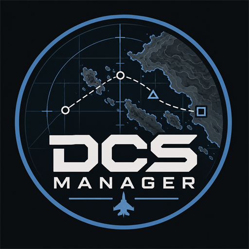

<div align="center">
  
</div>

# DCS Manager

🇬🇧 English | [🇫🇷 Français](README.fr.md)

An all-in-one companion for **DCS World** — debriefing collection, advanced statistics, airfield reference, aeronautical charts and flight planning. It runs **locally, on the same Windows machine as DCS**: one `dcsmanager.exe`, no server, no container, nothing to configure. It opens in **its own window**, like an ordinary application: no browser to launch, no address to remember.

Because it is local, it can read **DCS's own files** — the airfields, frequencies and beacons of every installed map, as well as the Saved Games folder — instead of relying on a hand-maintained dataset.

---

## Table of contents

- [Features](#features)
- [Architecture](#architecture)
- [Prerequisites](#prerequisites)
- [Installation guide](#installation-guide)
- [Quick start (PoC Phase 0)](#quick-start-poc-phase-0)
- [Configuration](#configuration)
- [Installing the Lua scripts into DCS](#installing-the-lua-scripts-into-dcs)
- [Deployment](#deployment)
- [Project structure](#project-structure)
- [Roadmap](#roadmap)
- [License](#license)

---

## Features

| Feature | Status | Details |
|---|---|---|
| Debriefings | ✅ Phase 3 | Network transfer of `debrief.log`, Lua parser and retained history, merged with missions in the **Flights** page with the full event timeline |
| Overview | ✅ New | Flight hours, missions, kills, kill/death ratio, last flight, DCS status, saved plans and recent checklists |
| Checklists | ✅ New | 13 generic templates, create/edit/duplicate/delete, JSON/CSV import-export and an execution view with per-device progress |
| Advanced stats | ✅ Phase 4 | Pilots, weapons, airframes, balance, network, recorded-mission selector and mission-by-mission trends (score, kills, landings) on the **Statistics** page |
| Aerodromes | ✅ Phase 6 | Read from DCS's own terrain files: **220 airfields listed, 146 mappable** across 6 installed maps, with Tower/TACAN/ILS/VOR/RSBN/NDB, and their charts. A bundled dataset covers Caucasus and Cold War Germany when DCS cannot be read |
| Aeronautical charts | ✅ Phase 6 | Approach plates and ground plans indexed from `maps_dcs/` and shown as documents |
| Installed modules | ✅ New | Terrains, aircraft, campaigns and tech packs, read from DCS's own inventory; **owned** (bought) and **installed** (on disk) shown apart |
| Career | ✅ New | A separate **Career** page with the player's logbook, favourite maps and countries, and a 30-day daily activity heatmap |
| Flight planning | ✅ New | Route editor with worldwide airports and DCS airfields, wind-corrected navlog and printable DCS briefing |
| Settings | ✅ New | One tab grouping the installed modules, the DCS-side install (mods, script state, shared `Export.lua`), the **player-profile backup** and the debug log as sub-tabs |
| Profile backup | ✅ New | Save/restore the logbook, bindings, options and scripts (and optionally kneeboard, missions, mods) as a portable zip, from the CLI, the API or Settings |
| Local by design | ✅ New | The desktop is one self-contained Windows `.exe`: SQLite persistence in `data/`, and every read (terrains, Saved Games) happens on the same machine as DCS |
| Web server (Docker) | ✅ New | Optional multi-user web application: accounts, roles, audit log, personal desktop tokens and one-way upload of finished missions. The desktop works without it; see [docs/docker.md](docs/docker.md) |
| Shared documents | ✅ New | Flight plans and checklists have an owner and `private`/`squadron` visibility; desktop ↔ server sync is last-write-wins with tombstones and conflict copies |
| Squadron tools | ✅ New | Aggregated dashboard, uploader and pilot filters, “my flights”, DCS-name highlighting, account ↔ pilot names, server backup download and conflict restore |
| Password recovery | ✅ New | Optional SMTP reset links with single-use, expiring tokens; an administrator can still reset a password |

> The live map (and its imagery) has been **removed**. Unit telemetry is still
> received and sampled: the current position supports the airfields tab (nearest
> field), and samples remain in the database for possible future analysis. The
> interface shows the overview, flights and debriefs, career, statistics, flight
> planning, checklists, airfields and settings.

### Lua installation

The manager reads DCS sessions through a small Lua export installed into DCS's
*Saved Games* folder. It carries unit telemetry, events, players and chat; the
same scripts feed debrief collection and statistics.

Close DCS, then open **Settings → DCS install → Install / update scripts**.
The installer detects Saved Games, installs three bundled files, preserves other
exports and existing user settings, and displays backups. It refuses to run while
DCS.exe is active. Start DCS again after installation.

### Advanced statistics (planned)

- **Pilot & career profile** — kills/deaths/KD, ejections, crashes, flight time, by **UCID**
- **Weapon analysis** — effectiveness per weapon, kill matrix, friendly-fire
- **Balance & meta** — coalition balance, aircraft flown, mission timeline
- **Network quality** — ping, disconnections, error codes
- **Analysis by engine** — exact **DCS type** granularity (`F-16C_50`, `T-72B`, `SA-10`…), platform + target + matchups

---

## Architecture

```
                      WINDOWS (one machine)
┌──────────────────────────────────────────────────────────┐
│ DCS World                                                 │
│  Scripts/Export.lua      → positions (UDP/JSON)           │
│  Scripts/Hooks/dcsmanager.lua → events/players/chat (TCP/JSON) │
└──────────────┬───────────────────────────────────────────┘
               │ 127.0.0.1 — nothing to configure
               ▼
┌──────────────────────────────────────────────────────────┐
│ dcsmanager.exe — Go backend + embedded Web UI                  │
│  • UDP + TCP listeners, in-memory state, SQLite (data/)   │
│  • debrief parser, statistics, airfield reference         │
│  • reads Mods/terrains/ and Saved Games/ directly         │
│  • REST + SSE, served to the native window (WebView2)     │
│    — or to a browser in `serve` mode                      │
└──────────────────────────────────────────────────────────┘
```

### Native window

The web UI is unchanged: it is simply shown in an **application window** (WebView2
component, bundled with Windows 10/11) instead of a browser tab. The HTTP server keeps
running behind the window — it is what serves the API — so nothing that existed is
lost: `dcsmanager serve` starts the manager in "browser" mode, for instance to reach it
from a second monitor or a tablet.

The manager refuses to start twice: if an instance already answers on
`DCSMANAGER_HTTP_ADDR`, window mode shows a message and stops, and `dcsmanager serve` exits
with code 3. In window mode, a log is written to `data/dcsmanager.log` (next to the
database), since a double-clicked executable has no console.

### Local by design

```
   dcsmanager.exe runs ON THE SAME WINDOWS MACHINE AS DCS
   → no LAN address to set, no firewall rule, no container
   → direct read access to Mods/terrains/ and Saved Games/
```

**Stack:** Go (backend, single binary + embedded UI) · Svelte + Vite (frontend) · SQLite (persistence).

---

## Prerequisites

### DCS side (machine A, Windows)

- DCS World (latest stable version or open beta)
- Access to `%USERPROFILE%\Saved Games\DCS\` (or `DCS.openbeta`)
- LuaSocket — bundled with DCS, no installation required

### Development / manager side

- **Go 1.26+** - <https://go.dev/dl/> (`winget install GoLang.Go`)
- **Node.js 20+** — <https://nodejs.org/> (only to build the frontend)
- **Git**

---

## Installation guide

A **custom Windows installer** is the only release artifact:
logo, dark theme, French/English, shortcuts, DCS detection, optional Lua scripts
and optional import of data from an older portable copy. Installed data stays in `%LOCALAPPDATA%\DCS Manager`
after upgrades and uninstall. See [the workflow, build and limitations
(French)](docs/installation-windows.fr.md). Build it with
`.\build.ps1` (requires Inno Setup 6.7+).
The app checks GitHub releases at startup and every 12 hours. A newer installer
appears in the sidebar and under **Settings → DCS install**, where you can also
check manually. Download and installation remain manual.

For a complete, step-by-step installation — release download, Lua script
installation, first launch, configuration, troubleshooting — see
**[`docs/installation.md`](docs/installation.md)**.

---

## Quick start

Install the application with `DCSManager-Setup-<version>.exe`, then use the Start
menu shortcut. The application connects DCS telemetry to its local interface.

### 1. Start the manager

```powershell
# Development from source only:
Set-Location backend
go run ./cmd/dcsmanager
```

By default, the backend listens on:

- `127.0.0.1:7776` over **UDP** (positions)
- `127.0.0.1:8080` over **HTTP** in `serve` mode (Web UI + SSE); window mode can pick a free port

The manager then opens in a **native window**. In `serve` mode it opens no window and
the interface is reached at <http://localhost:8080>.

### 2. Install the Lua scripts into DCS

Close DCS, then open **Settings → DCS install → Install / update scripts**.
See [Installing the Lua scripts into DCS](#installing-the-lua-scripts-into-dcs)
for the installed files and the CLI alternative.

### 3. Launch DCS and a mission

The manager picks the session up: events and players are recorded, and each
mission is saved for the debriefs and the statistics.

---

## Configuration

All configuration is done through **environment variables** (prefix `DCSMANAGER_`, kept for
compatibility) with sensible defaults. None of them is required for a normal install.

| Variable | Default | Description |
|---|---|---|
| `DCSMANAGER_HTTP_ADDR` | `127.0.0.1:8080` | HTTP listening address (Web UI + SSE). A port of `0` picks a free one automatically (native window). Set `0.0.0.0:8080` to reach the UI from another device; the API has no authentication unless `DCSMANAGER_API_TOKEN` is set |
| `DCSMANAGER_API_TOKEN` | *(empty)* | When set, non-loopback callers must present it (Authorization: Bearer, or `?token=`) to reach the manager. Required when exposing it beyond the local machine (e.g. a plugin on another host). Local (loopback) access is always allowed |
| `DCSMANAGER_UDP_ADDR` | `127.0.0.1:7776` | UDP listening address (unit telemetry). Not 7778: **DCS-BIOS owns that port**, and the two are meant to run together |
| `DCSMANAGER_TCP_ADDR` | `127.0.0.1:7779` | TCP listening address (events + commands) |
| `DCSMANAGER_DB_PATH` | `./data/dcsmanager.db` | SQLite database path |
| `DCSMANAGER_MODE` | `desktop` | `server` runs the multi-user web application without DCS ingestion |
| `DCSMANAGER_ADMIN_USER` | *(empty)* | First administrator, created only when the users table is empty |
| `DCSMANAGER_ADMIN_PASSWORD` | *(empty)* | First administrator password (10 characters minimum); ignored once an account exists |
| `DCSMANAGER_SECURE_COOKIES` | `false` | Mark session cookies `Secure` when served through HTTPS |
| `DCSMANAGER_SMTP_HOST` | *(empty)* | SMTP host for password-recovery email; empty disables the feature |
| `DCSMANAGER_SMTP_PORT` | `587` | SMTP port (STARTTLS) |
| `DCSMANAGER_SMTP_USER` | *(empty)* | SMTP username |
| `DCSMANAGER_SMTP_PASSWORD` | *(empty)* | SMTP password |
| `DCSMANAGER_SMTP_FROM` | `no-reply@localhost` | Sender address for reset emails |
| `DCSMANAGER_PUBLIC_URL` | `http://localhost:8080` | Public URL used in password-reset links |
| `DCSMANAGER_PASSWORD_RESET_TTL` | `1800` | Reset-link lifetime in seconds |
| `DCSMANAGER_DATA_ROOT` | `%LOCALAPPDATA%\DCS Manager` | Override the user data folder (portable installs and tests) |
| `DCSMANAGER_DB_ENABLED` | `true` | Enable persistence (otherwise everything in memory) |
| `DCSMANAGER_THEATRE` | `Caucasus` | Default theatre |
| `DCSMANAGER_UNIT_TTL` | `5` (seconds) | Delay before a silent unit disappears |
| `DCSMANAGER_CATEGORIES` | `./categories.json` | Override for engine classification |
| `DCSMANAGER_MAX_UNITS` | `5000` | Maximum number of tracked units |
| `DCSMANAGER_TRACK_INTERVAL` | `3` (seconds) | Position sampling frequency |
| `DCSMANAGER_TRACK_GRACE` | `15` (seconds) | Absence before a unit counts as lost |
| `DCSMANAGER_TRACK_RETENTION` | `86400` (seconds) | History retention duration |
| `DCSMANAGER_SAVED_GAMES` | *(auto)* | DCS Saved Games folder, when auto-detection fails |
| `DCSMANAGER_CHARTS_DIR` | `./maps_dcs` | Aeronautical chart scans (approach plates, ground plans) |
| `DCSMANAGER_SOURCE` | *(auto)* | Force the session source: `live` or `test` (see below) |
| `DCSMANAGER_LOG_LEVEL` | `info` | `debug`, `info`, `warn`, `error` |
| `DCSMANAGER_DEBUG` | `false` | Live debug logging (actions, API requests, DCS export). Also toggled from Settings → Debug |

### DCS side — `Saved Games\DCS\Config\dcsmanager.cfg`

```lua
-- Backend address (the manager runs locally)
dcsmanager_host = "127.0.0.1"
dcsmanager_udp_port = 7776
dcsmanager_tcp_port = 7779

-- Telemetry
dcsmanager_send_interval = 1.0    -- player position (seconds)
dcsmanager_world_enabled = true   -- export all objects
dcsmanager_world_interval = 2.0   -- object list (seconds)
dcsmanager_world_radius = 0       -- radius filter in km (0 = all)
```

---

## Installing the Lua scripts into DCS

> ⚠️ **Always merge, never overwrite.** `Export.lua` is very often already modified by
> Tacview, SRS, DCS-BIOS, etc. Back up the existing file before any modification.

The scripts go into DCS's *Saved Games* folder:

```
%USERPROFILE%\Saved Games\DCS\          (or DCS.openbeta)
├─ Config\
│   └─ dcsmanager.cfg          ← backend address configuration
└─ Scripts\
    ├─ Export.lua             ← telemetry; merged with existing exports
    └─ Hooks\
        └─ dcsmanager.lua      ← events, players, chat
```

1. Close DCS and start the updated application.
2. Open **Settings → DCS install**, check the detected folder, then click
   **Install / update scripts**. Existing exports and configuration are preserved;
   changed files are backed up. The script status refreshes immediately.
3. Start DCS and load a mission.

PowerShell alternative from the executable's folder:

```powershell
.\dcsmanager.exe install-lua --saved-games "$env:USERPROFILE\Saved Games\DCS" --dry-run
.\dcsmanager.exe install-lua --saved-games "$env:USERPROFILE\Saved Games\DCS"
```

The CLI can update an existing configuration, with backup; the one-click installer
preserves it. Use the build's own executable when testing from source.
If detection fails, set `DCSMANAGER_SAVED_GAMES` before starting the application.

---

## Deployment

### Windows installer

```powershell
# 1. Build the installer
.\build.ps1

# 2. Run the generated installer
$version = (Get-Content VERSION -Raw).Trim()
& ".\dist\DCSManager-Setup-$version.exe"
```

The installer offers to install the Lua scripts and creates the Start menu
shortcut. The application opens in its own window.

### CLI

```powershell
dcsmanager                 # opens the manager in a native window
dcsmanager serve           # starts the server only; UI at http://localhost:8080
dcsmanager server          # multi-user web application (Docker/LAN)
dcsmanager install-lua     # installs/merges the Lua scripts into Saved Games
dcsmanager uninstall-lua   # removes the installed block (keeps the config)
dcsmanager status          # installed / outdated / missing, per file
dcsmanager purge           # deletes recorded sessions (destructive)
dcsmanager backup          # saves a DCS player profile to a portable archive
dcsmanager restore         # restores a profile archive into Saved Games
dcsmanager version
```

### Docker web application

The optional server is a separate container; the desktop never depends on it.

```bash
cp .env.example .env         # set DCSMANAGER_ADMIN_PASSWORD
docker compose up -d --build
```

Open `http://<server-ip>:8080`, sign in as the administrator, create a desktop
token under **My profile → Desktop tokens**, then paste it on the desktop in
**Settings → Server sync**. Full instructions, HTTPS and backup: see
[docs/docker.md](docs/docker.md) (French: [docs/docker.fr.md](docs/docker.fr.md)).

### Test sessions and `purge`

The test tools (`tools/send-telemetry.mjs`, …) speak exactly the same protocol as
DCS, so a session recorded while they are running is indistinguishable from a real
flight. Every session is therefore tagged with a **source**:

- `live` — recorded from DCS. Statistics count these.
- `test` — recorded from the test tools. Kept on disk, but **excluded from
  career statistics** unless explicitly requested.

Detection is automatic: the backend recognises the fixture callsigns used by
`tools/send-telemetry.mjs`. Set `DCSMANAGER_SOURCE=test` (or `live`) to force the
verdict when you use your own fixtures.

```powershell
dcsmanager purge --source test          # delete simulated sessions only
dcsmanager purge --mission-id 3         # delete one mission and everything linked to it
dcsmanager purge --all                  # delete every recorded session
dcsmanager purge --source test --dry-run  # show what would be deleted, delete nothing
```

Statistics accept `?includeTest=1` to include simulated sessions deliberately.
The **Career** and **Statistics** pages each have an independent period selector
(today, current week or month, last 6 or 12 months, all time, or a custom date
range). Periods select whole missions by their local start date. For a selected
period, Career shows a pilot's missions recorded by DCS Manager. All time shows
the DCS logbook. DCS does not date its logbook totals, so historical flight
hours, rank, awards and per-airframe totals cannot be filtered by period.

Career insights count missions by map and country for the selected pilot. The
heatmap estimates cockpit time from manager snapshots over the last 30 days,
independent of the selected ranking period; long gaps are excluded. Earlier
records did not store the country. To collect it for future flights, update the
Lua scripts with DCS closed through **Settings → DCS installation → Install /
update scripts**.

---

## Project structure

```
DCS Manager/
├─ README.md                 # English (primary)
├─ README.fr.md              # French
├─ CHANGELOG.md / .fr.md
├─ VERSION
├─ Makefile / build.ps1       # build commands (winres target regenerates the icon)
├─ install-dcs.ps1           # installs the Lua scripts into Saved Games
├─ dcs-lua/                  # scripts to install on the DCS side
│   ├─ Config/dcsmanager.cfg      # configuration template
│   ├─ Export.lua            # positions → UDP (live map)
│   └─ Hooks/dcsmanager.lua       # events / players / chat
├─ backend/                  # Go
│   ├─ go.mod
│   ├─ cmd/dcsmanager/main.go     # CLI (desktop / serve / install / purge)
│   ├─ internal/
│   │   ├─ desktop/          # native window (WebView2, pure Go)
│   │   ├─ app/              # manager wiring, shared by desktop / serve
│   │   ├─ config/           # env loading + defaults
│   │   ├─ install/          # Lua injector (merge via markers)
│   │   ├─ aerodrome/        # aerodromes and frequencies (embedded data)
│   │   ├─ category/         # engine classification (DCS type → family)
│   │   ├─ theatre/          # DCS theatres
│   │   ├─ charts/           # aeronautical chart scans (maps_dcs/)
│   │   ├─ model/            # types exchanged DCS ↔ backend
│   │   ├─ lua/              # Lua data parser (debrief.log)
│   │   ├─ debrief/          # debrief analysis
│   │   ├─ debriefstore/     # reassembly of debrief transfers
│   │   ├─ udp/              # unit telemetry receiver
│   │   ├─ tcp/              # event / player / chat receiver
│   │   ├─ live/             # in-memory session state
│   │   ├─ ingest/           # live → database bridge
│   │   ├─ tracker/          # position history + loss detection
│   │   ├─ db/               # persistence: SQLite store behind the Store interface
│   │   ├─ backup/           # player-profile save/restore (zip)
│   │   ├─ state/            # unit store (in memory)
│   │   ├─ stats/            # statistical aggregations
│   │   └─ api/              # REST + SSE + embedded UI (dist/)
├─ frontend/                 # Svelte + Vite
│   └─ src/
│       ├─ App.svelte
│       └─ lib/              # components and stores
├─ maps_dcs/                 # aeronautical chart scans (local, not versioned)
├─ tools/                    # test telemetry emitter
└─ docs/                     # documentation
```

---

## Roadmap

- [x] **Phase 0 — PoC**: `Export.lua` (player position) → Go → UI
- [x] **Phase 2 — Events & players**: `onGameEvent`, `net.get_stat`, SQLite history (the Session tab is now removed; events and players are still recorded for the stats and the debriefs)
- [x] **Phase 3 — Debriefings**: network transfer of `debrief.log`, Lua parser, history
- [x] **Phase 4 — Advanced stats**: overview, pilots, weapons, engines, balance, network
- [x] **Phase 4 bis — Telemetry collection**: position and loss samples remain stored; analytical maps and sortie calculations were removed
- [x] **Phase 5 — Packaging**: CLI, safe Lua injector, single self-contained binary
- [x] **Phase 6 — Aerodromes**: read from DCS's own terrain files (frequencies, aids, charts)
- [x] **Flight planning**: worldwide airports and DCS airfields, wind-corrected navlog, printable DCS briefing
- [x] **UI redesign and checklists**: addressable pages, overview, flights, checklists with templates and import/export
- [x] **Multi-user server (Docker)**: accounts, roles, personal tokens, audit log and desktop upload
- [x] **Shared documents**: ownership, visibility and bidirectional sync for flight plans and checklists
- [x] **Squadron tools**: filters, account/pilot names, server backup and conflict restore
- [ ] **Phase 1 - Live map**: removed; telemetry is still collected

The full, detailed plan is available in the project's plan file.

---

## License

[MIT](LICENSE) © 2026 Laurent (lolo1580)

This is a community project, not affiliated with or endorsed by Eagle Dynamics.
"DCS World" and its terrains are trademarks of Eagle Dynamics SA.
